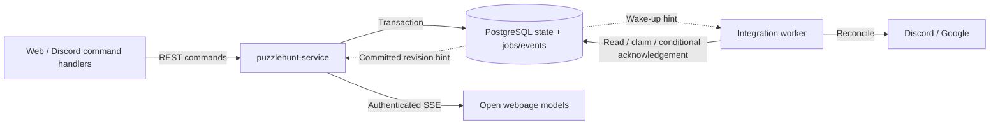

# Puzzlehunt model architectural decisions

This is a reviewable record for the opt-in prototype, not authorization to switch
existing Fluid consumers. Entries distinguish user-confirmed direction from
implementation choices made here. Tooling and deployment remain open; the initial
HTTP authorization policy is recorded below.

## 1. Keep the domain and its adapters in the model package

**Status:** Implemented in checkpoint `e0a3be2`; package layout is an implementation choice.

The model package owns domain commands, snapshots, projections, the PostgreSQL
adapter, its schema, and its tests. Use separate `document` and server-only
`postgres` entry points, rather than another domain/store workspace package or a
dependency on the bot. The schema is an exported SQL asset; applying it is explicit.

The PostgreSQL adapter still accepts an injected connection pool. Moving it
changes no transaction, receipt, outbox, or graph-validation behavior. Existing
Fluid exports and consumers remain unchanged. PGlite tests move with the adapter;
they exercise SQL constraints but do not prove multi-connection locking.

**Reason:** Code ownership should follow responsibilities, not the first process
chosen to host them. Keeping one package and explicit entry points is the smallest
separation; browser-facing entries must not import PostgreSQL or platform clients.

## 2. Separate optimistic visibility from authoritative commitment

**Status:** User-confirmed direction; implemented after the checkpoint.

Preserve a familiar synchronous local mutation API where useful. A facade tracks
committed state and pending semantic commands, exposes their projected effects,
and provides explicit asynchronous settlement and failures. It never sends a
replacement document. Server write order and server timestamps remain authoritative.

Use the existing `HuntDocumentClient` boundary rather than inventing another
command/transport interface. The bot and website can both use an HTTP adapter;
a local adapter is also useful for tests and initial cohosting.

Pending-command rejection, rebasing, and acknowledgement handling must be tested.
Do not add a disconnected-edit protocol or duplicate the domain rules in a UI.

The `model` entry point now exports `IPuzzlehuntModel`, plain read-only views, and
the optimistic `PuzzlehuntModel`. Familiar methods delegate to the existing
command reducer. The `fluid` entry point adds `FluidPuzzlehuntModel`, a small
adapter over the existing `IPuzzlehunt`; it does not reimplement Fluid persistence.
The legacy package root remains compatible.

## 3. External integrations consume durable server intent

**Status:** User-confirmed direction; worker implementation remains deferred.

The bot handles interactions and relevant Discord gateway events. Application
service workers perform Discord/Google reconciliation through external APIs.
Workers consume transactionally recorded events/jobs and current desired state,
not optimistic facade notifications or Fluid `TreeView` diffs.

Initially these responsibilities may share a process. Neither package ownership
nor the model API should require that. Creation journals, leases, retry recovery,
and external-effect repair are still prerequisites for enabling workers.

## 4. Test the model contract independently of representation

**Status:** Implemented and exercised against both local services.

Use one behavioral suite with backend fixtures, not duplicated Fluid and SQL
assertions. Fixtures own service setup, isolation, synchronization, and disposal.
The existing Fluid implementation runs against the local ordering service; the
PostgreSQL implementation runs against a disposable local PostgreSQL database.
Retain backend-specific SQL and Fluid delta tests where they test representation.

The shared suite covers existing common behavior. The user-confirmed new-path
solve/status/logging changes remain explicitly PostgreSQL-specific; a fixture
must not silently compensate for or change legacy Fluid behavior.

The single contract suite is `src/test/model/contract.ts`; the backend test files
only provide fixtures. Coverage includes immediate local visibility, persisted
reload identity, depth-first/sibling ordering, nested moves/deletion, properties,
solve/unsolve, statuses, subscriptions, concurrent additions and independent
assignments, and later service-ordered solves.

Additional real PostgreSQL tests force simultaneous row-lock waits, race cyclic
moves, read during an uncommitted metadata/node write, and retry a lost solve
acknowledgement after a newer solve. They also verify that database time replaces
a deliberately skewed optimistic status timestamp. PGlite remains the faster SQL-constraint suite,
not a substitute for these multi-connection tests.

## 5. Use one FIFO pipeline for commands and refreshes

**Status:** Implementation choice; rejection policy was explicitly confirmed by the user.

Only one command/read is in flight per optimistic `PuzzlehuntModel` instance.
Different models still submit concurrently; PostgreSQL determines authoritative
write order per hunt. The Fluid adapter retains Fluid's own ordering protocol.
Batch creation remains one command. Acknowledgements retire their command before
remaining commands are projected over the returned snapshot.

Refresh requests enter that same pipeline. This deliberately avoids a more complex
protocol for determining which pending commands are already reflected in an
independently fetched snapshot. An invalidation queues a refresh rather than
installing arbitrary snapshots directly. Older revisions and mismatched scopes
cannot replace current state.

Definitive `HuntCommandError` rejections roll back the edit. Reprojecting from
authoritative state explicitly fails queued edits that no longer apply, while
independent edits proceed. Failures remain inspectable until `clearFailures()`.
A non-domain failure has an uncertain commit result: retain the original command
ID/payload, pause the queue, expose the error, and resume through `retryPending()`.
Do not silently regenerate IDs, discard unknown outcomes, or automatically retry
forever. The HTTP adapter now translates matching explicit server rejections into
the domain error contract, including authorization failures. Malformed responses
and 5xx responses never count as proof of rejection.

**Trade-off:** A slow/uncertain write also delays this model's refreshes. This is
the simpler initial protocol, not a fully disconnected editor. `flush()` confirms
the current drain/batch, not one selected command; call it immediately after an
action that needs confirmation. It rejects if that batch fails or pauses. Earlier
failures stay visible even when a later batch succeeds.

## 6. Expose stable IDs and plain views, not tree-specific diffs

**Status:** Implementation choice consistent with the confirmed model direction.

The common interface retains familiar model operations and round child lists, but
IDs are strings and notifications are parameterless invalidations. Read fresh
values after notification; returned views are immutable values, not live handles.
Both backends use the same parent-pointer view projection and depth-first ordering.

The Fluid adapter uses SharedTree's existing stable-ID conversion, rather than a
new identity map or exposing session-local compressed numeric IDs. Tree access is
isolated to that adapter. It preserves legacy solve/status semantics and client
timestamps. An additive typed `unsolve` method removes the answer trait; existing
callers have not been switched. Worker-only Discord association writes are not
part of the ordinary model interface.

`flush()` on Fluid waits for service acknowledgement; remote readers still receive
changes asynchronously. Its `refresh()` flushes local changes because remote
updates are already streamed. Fixtures wait for actual convergence rather than
assuming every observer has processed an acknowledged change.

## 7. Own disposable services in the tests

**Status:** Implementation choice; verified on this Windows worktree.

Use the existing Azure local service (Tinylicious) for Fluid ordering, and
test-only `embedded-postgres` plus `pg` for a real PostgreSQL service. No global
PostgreSQL/Docker installation, external database URL, production driver bootstrap,
or Azure resource is required. Each database fixture owns a temporary cluster,
binds to loopback, resets hunt tables before each test, and shuts down afterward.
Native PostgreSQL is only a development dependency; this does not select an ORM
or production database version. On Unix, run as a non-root user; the fixture does
not create host accounts. Automatic dependency-symlink rehydration avoids requiring
installer scripts for the native test binaries.

Vitest's `globalSetup` owns a local ordering-service child process, dynamic port,
temporary storage/log directory, readiness check, and returned teardown. Tests use
Vitest's typed `provide`/`inject` endpoint; the package runs `vitest run` directly.
An optional `PUZZLEHUNT_FLUID_ENDPOINT` selects an already running service, which
the suite does not stop or reset. The owned service launches Node directly:
`start-server-and-test@1.15.5` used `ps-tree@1.2.0`, whose Windows cleanup spawns
`wmic.exe`. That executable is absent on this host but may exist on other Windows
installations. No operating-system fix or PostgreSQL setting was involved.
Vitest explicitly includes source tests only, preventing a build's emitted tests
from running again.

A test-only declaration re-exports `embedded-postgres`' own types for the repository's
legacy TypeScript Node resolver. It avoids duplicating its API or changing every
package's module-resolution strategy.

## 8. Add an HTTP transport and an independently hosted application service

**Status:** Implemented; guild-member access and a separate trusted-bot credential
were explicitly confirmed by the user. Package layout and wire details are
implementation choices.

The model's browser-safe `http` entry point implements `HuntDocumentClient`.
`PuzzlehuntModel` remains the only optimistic command facade; HTTP introduces no
second domain implementation. Tokens are obtained per request. There are no
automatic retries, cookies, redirect following, or change subscriptions.

`packages/puzzlehunt-service` owns the Express host, production PostgreSQL pool,
Discord authorization, startup configuration, and shutdown. It depends on the
existing model/store entry points, never the Discord gateway bot. This separate
executable can run in a Container App without making the bot a required host.
Existing bot/site Fluid paths are not switched.

Any current Discord guild member may read and edit that guild's hunts through an
OAuth token with the existing `guilds` scope. Trusted-bot requests use a separate
service credential and `Service` authorization scheme, distinct from OAuth
`Bearer` tokens so invalid service keys are never forwarded to Discord. The
service checks the configured bot's guild access with
Discord rather than trusting a client-supplied guild assertion. The URL scopes
authorization, and the database independently checks hunt ownership. Public JSON
cannot change ownership/configuration or invoke worker-only commands.

Expose active selection at `/guilds/:guildId/hunts/active`, returning a snapshot,
instead of changing the old Fluid-context endpoint. Snapshot reads and command
submissions have scoped GET/POST routes. JSON decoding and a 1 MiB request limit
sit before the typed store. Commands return only after commit.

Only recognized JSON rejection envelopes with matching 4xx statuses are
definitive. Authentication/authorization failures join the existing
`HuntCommandError` contract, so rollback/rebasing needs no HTTP-specific model
branch. Network failures, timeouts, invalid snapshots/receipts, and all 5xx
responses retain the pending command and its original ID, because commit status
can be unknown. Unexpected server errors are logged, not returned verbatim.

## 9. Preserve a local application test seam without adding that suite yet

**Status:** User-confirmed priority; application tests explicitly deferred by the user.

The executable composes the exported `createPuzzlehuntApp` factory with a real
store and Discord authorizer. The factory has no environment, listen, or database
startup side effects. A future test host can inject a disposable local PostgreSQL
pool through the store and substitute the authorizer, then use an ephemeral
loopback HTTP port with the real client. No production authentication bypass or
automatic database reset is introduced. The shared PostgreSQL fixture resolves
the schema's package export, so source and compiled test hosts use the same asset.

Discord membership checks require network access in production. Substituting
that boundary is necessary for deterministic, fully local application tests;
there is no other known architectural obstacle. The existing model/service
contract suite remains unchanged. New tests cover the protocol, transport, and
authorization/configuration functions, not a local HTTP-plus-database application
suite. Notifications/reconnection, external workers, consumer cutover, provisioning,
and deployment remain separate follow-up work.

## 10. Simplify commands and share the core model interface

**Status:** Implemented from user review feedback.

Use only `add`, `delete`, `move`, and `set-property` commands. A mapped union ties
each known property name to its value type; nullable properties use explicit
`null` to clear. Public properties are `name`, `url`, `answer`, `status`, and
`sheetId`. Worker-only `discord` assignments use the same shape but remain a
separate command type, not part of the public HTTP allowlist. Answer/status
assignments retain their domain side effects and distinct integration events;
this is not unrestricted object patching.

The shared generic `IPuzzlehunt` defines common reads and mutations once. The
legacy interface specializes it for Fluid handles/numeric IDs and adds existing
metadata, Discord association, and tree event APIs. `IPuzzlehuntModel` specializes
it for stable IDs/plain views and adds subscriptions and asynchronous settlement.
The earlier duplicated signatures were a compatibility shortcut, not a required
architectural boundary. Existing Fluid implementations and consumers keep their
behavior.

Both projections build and sort a parent-to-children index once, rather than
scanning every node for each round. `validateHuntDocument` names the existing
graph validation explicitly.

## 11. Use Zod at the REST boundary

**Status:** Implemented from user review feedback; no ORM selection implied.

Shared Zod schemas validate public requests and response snapshots/receipts.
Strict request objects reject unknown and privileged fields; response objects
allow unrelated additional fields for compatibility. Graph validation and
request-specific scope/receipt matching remain semantic checks.

Malformed requests become definitive `invalid-command` rejections. Malformed
responses, including invalid graph invariants, remain `HuntProtocolError` with
the validation cause, never a definitive rejection of a possibly committed edit.
Readable domain interfaces remain independent of Zod, with schema output types
checked against them. Explicit nullable schema types preserve required fields
for the legacy non-strict TypeScript build without weakening runtime validation.

## 12. Change notification architectures

**Status:** SSE plus PostgreSQL `LISTEN` selected by the user. The
[wire protocol](DATABASE_MODEL.md#proposed-change-notification-protocol) is a
proposal for review; notification delivery is not implemented.

Separate two requirements: open webpages need to learn that their snapshot is
stale; Discord/Google synchronization must eventually perform durable work even
when no webpage or worker was connected at the time of a change. Neither requires
streaming every model operation. The committed snapshot and integration tables
remain authoritative.

| Architecture | Webpage updates | Integration worker updates | Trade-off |
| --- | --- | --- | --- |
| Polling only | Periodically queue a snapshot refresh; also refresh on focus/reconnect. | Poll due durable jobs/events at startup and on a timer. | Fewest moving parts and no extra infrastructure, but either seconds of latency or frequent idle requests. An optional new revision-only endpoint could avoid sending unchanged snapshots. |
| PostgreSQL `LISTEN` plus application SSE | Each service replica listens for committed hints and fans out `{ huntId, revision }` to its authorized HTTP subscribers. | An in-process worker shares the wake-up source; a separate trusted worker can have its own listener. Both also scan durable work. | Selected for the current low-usage, low-latency target: no additional managed service, but the application owns streaming connections and listener recovery. |
| Managed fan-out, such as Azure Web PubSub | The service authorizes hunt-scoped subscriptions; a publisher sends revision hints through the managed service. | Still consume durable jobs/events, directly or through a separately designed durable queue. | Offloads connection management and scaling, but adds infrastructure, authorization, a reliable publisher, and cost. Not automatically transactional with PostgreSQL. |

**Selected flow:** retain REST for reads/commands, use server-to-client
invalidation messages, and keep integrations independent of browser sessions.

The store already commits `pg_notify('hunt_changed', ...)` with state and
integration intent. PostgreSQL delivers those notifications after commit to all
currently listening sessions. Each application replica needs one dedicated,
session-affine listener connection, not one database connection per browser and
not a transaction-pooled connection. This supports fan-out across replicas;
process-local events alone would miss writes handled by another replica or
worker.

For browsers, propose an authorized, hunt-scoped `/changes` stream carrying only
revision hints. Establish and commit database `LISTEN`, then attach the
server-side subscription before reading its initial revision. This first message
also closes the race when a client loads its snapshot before opening the stream.
Coalesce hints and feed them through the model's existing queued `refresh()`,
rather than installing snapshots outside its pending-command pipeline. Reconnects
receive a fresh revision baseline; page focus and low-frequency safety refreshes
also re-read current state. Recovery does not depend on replaying missed hints.
On database-listener failure, close affected streams so that reconnecting clients
receive a fresh baseline after listening resumes. Disconnect slow clients instead
of buffering an unbounded notification history.

Use a fetch-based SSE client to retain the current bearer-token authorization;
native browser `EventSource` cannot set the required Authorization header. Do not
put OAuth/service credentials in stream URLs. Authorize the requested hunt/guild,
refresh credentials on reconnect, and bound stream authorization lifetimes.
Azure Container Apps documents a 240-second HTTP request timeout: verify actual
streaming/proxy behavior locally and in the deployment, and support bounded
streams/reconnects rather than assuming an indefinite connection. Heartbeats are
not a substitute for handling a total request timeout. Long polling is a viable
transport alternative using the same listener/fan-out architecture. WebSockets
also work, but bidirectional transport is unnecessary while commands remain REST.
Long-lived open requests can keep application replicas active; do not assume
scale-to-zero savings while clients are connected.

Workers must scan pending jobs/events on startup and periodically, including
retries whose `available_at` becomes due without a new notification. Wake-up hints
only reduce latency. Reconcile current desired state and conditionally acknowledge
the exact generation; preserve distinct lifecycle/log events. Leases, retry
scheduling, and external-effect recovery still need implementation. A separately
hosted worker can access this through trusted server-side database access or new
private claim/acknowledgement endpoints; the public model API is not that worker
API. If the Discord gateway process also holds a model for commands, it can use
the same scoped invalidation stream as the webpage.

Managed fan-out likewise needs a durable outbox publisher/retry path: publishing
after commit alone can lose a notification if the process exits between commit
and publish. It does not replace the integration jobs/events or provide exactly
once external effects. Scaling the publisher to zero also requires an explicit
reliable wake-up/recovery mechanism, not reliance on an absent database listener.

The selected option remains fully locally testable with PostgreSQL and HTTP,
without an Azure dependency. Future notification tests should exercise multiple
service replicas, subscription/read races, disconnected clients/listeners, and
worker restart recovery. No such application suite is added in this checkpoint.

References: PostgreSQL [LISTEN](https://www.postgresql.org/docs/current/sql-listen.html)
and [NOTIFY](https://www.postgresql.org/docs/current/sql-notify.html);
[Container Apps ingress](https://learn.microsoft.com/en-us/azure/container-apps/ingress-overview);
[Azure Web PubSub](https://learn.microsoft.com/en-us/azure/azure-web-pubsub/overview).

## 13. SQL organization and TypeScript tooling

**Status:** Evaluation requested by the user; no query tool or ORM adopted.

Parameterized SQL in a PostgreSQL adapter is idiomatic `node-postgres`, not an
architectural problem. Query text is static and values use `$1`, `$2`, etc.; the
current code does not concatenate user input into SQL. Keeping transaction and
locking behavior explicit is useful here. Moving query text to another file does
not itself make it safer or type checked.

The current weakness is manual duplication: `query<HuntRow>(...)` tells TypeScript
what rows to assume; it does not check the SQL, selected columns, parameter types,
or nullability against PostgreSQL. The following are reasonable alternatives:

| Pattern | Source of truth and benefit | Cost |
| --- | --- | --- |
| SQL files with PgTyped | Keep SQL DDL and named SQL queries; generate parameter/result types by checking queries against a local database. Removes long SQL strings from application control flow. | Adds a reproducible generation/check step against an applied schema. |
| Kysely with database type generation | Keep SQL DDL; introspect it into TypeScript database types, then express most queries in a typed query builder. | Adds a query API and generation step; PostgreSQL-specific operations may still use SQL fragments. |
| Drizzle | Declare tables/constraints in TypeScript, infer query types, and generate migrations from that schema. | Changes the schema-authoring workflow; generated columns, composite constraints, partial indexes, and locking semantics still require deliberate verification. |
| Keep `pg`, extract named queries/modules | Smallest organizational change; no new query abstraction. | Does not address unchecked handwritten parameter/result types by itself. |

For the current SQL-first prototype, prefer evaluating **SQL files with PgTyped**
first if the concern is embedded SQL and repeated types. Choose **Kysely plus
code generation** instead if TypeScript query composition is the desired
experience. Drizzle is worth considering if TypeScript should become the schema
source of truth, but it is not necessary to make this architecture conventional.
Do not silently migrate the persistence layer as part of this review.

No tool removes the need to understand transactions, per-hunt row locking,
conditional acknowledgements, or external-effect retry semantics. Generated
database types also do not automatically turn CHECK constraints into domain
discriminated unions or describe arbitrary aggregated JSONB contents; the
database-to-document projection remains a real boundary. Zod validates REST
data and is complementary to, not a replacement for, database query typing.

References: [node-postgres queries](https://node-postgres.com/features/queries);
[PgTyped](https://pgtyped.dev/docs/);
[Kysely type generation](https://kysely.dev/docs/generating-types);
[Drizzle schema declarations](https://orm.drizzle.team/docs/sql-schema-declaration).
